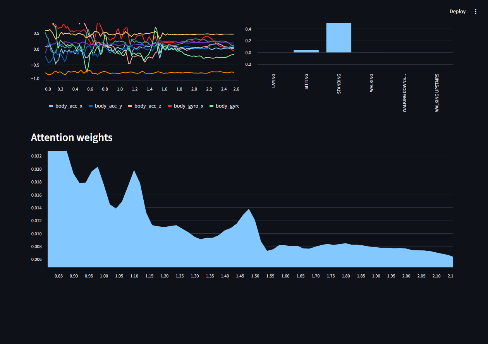

# Human Activity Recognition with an Attention-BiLSTM

This repository implements the Fall 2026 Applied Machine Learning Assignment 4 using the raw UCI HAR inertial-signal dataset only.

## Team

Add both member names and GitHub usernames here before final submission.

## Data

Download `UCI HAR Dataset.zip` only from the [UCI dataset page](https://archive.ics.uci.edu/dataset/240/human+activity+recognition+using+smartphones) and place/unzip it under `data/`. The dataset is not committed.

Expected layout:

```text
data/UCI HAR Dataset/train/Inertial Signals/
data/UCI HAR Dataset/test/Inertial Signals/
```

## Setup

```bash
python -m pip install -r requirements.txt
```

## Run the complete pipeline

```bash
python src/load_data.py
python src/plot_windows.py
python src/prepare.py
python src/train.py
python src/test_model.py
streamlit run app/app.py
```

From the repository root. `src/train.py` trains for exactly 30 epochs, clips gradients to total norm 1.0, and saves the lowest-validation-loss checkpoint to `results/best_har_model.pt`.

## Repository layout

- `src/load_data.py`: UCI raw-signal loader
- `src/plot_windows.py`: example-window plot
- `src/prepare.py`: subject split, relabeling, and standardization
- `src/layers.py`: RNN, LSTM, bidirectional LSTM, and attention
- `src/model.py`: HARNet
- `src/train.py`: 30-epoch training
- `src/metrics.py`: accuracy and confusion-matrix functions
- `src/test_model.py`: test and figure generation
- `results/`: plots, model, tables, and analysis
- `app/app.py`: Streamlit front end

## Communication

- Blog draft: `blog.md`
- LinkedIn draft: `linkedin_post.md`

Replace the repository placeholder links and publish both drafts before submission.

## Front-end screenshot


