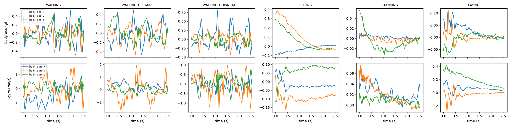
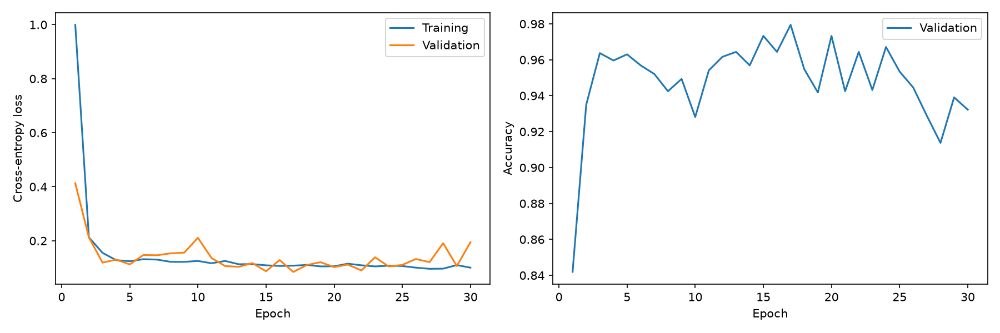
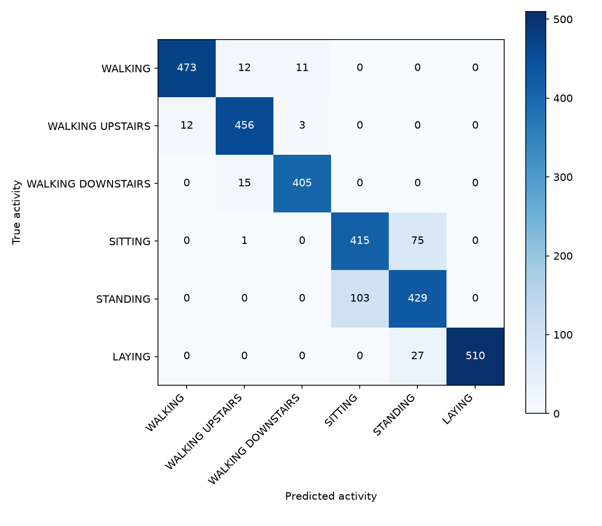
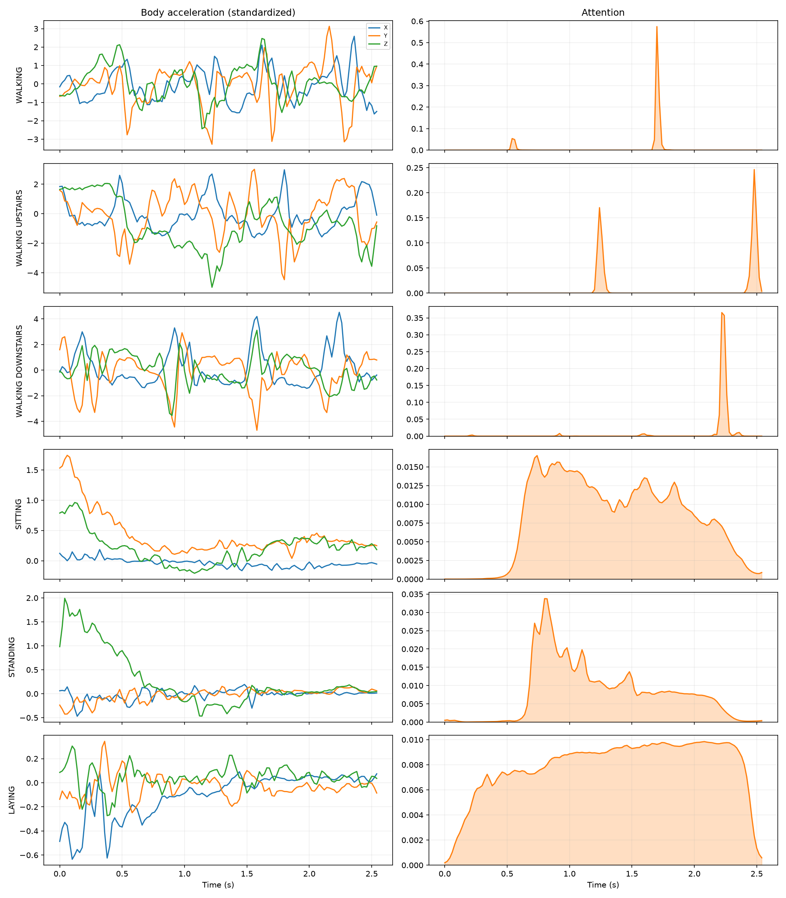
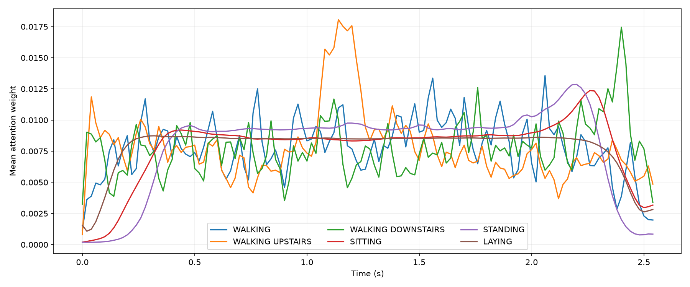

# Teaching a Neural Network to Read a Phone's Motion

*Draft of an 800–1500 word Medium article.*

## The problem

Every window contains 128 samples at 50 Hz, or 2.56 seconds of raw motion. Nine channels describe body acceleration, gyroscope angular velocity, and total acceleration. The task is to classify a window as WALKING, WALKING UPSTAIRS, WALKING DOWNSTAIRS, SITTING, STANDING, or LAYING.

## Data and preparation

The UCI Human Activity Recognition dataset contains 7,352 training windows from 21 volunteers and 2,947 test windows from nine other volunteers. I downloaded the raw inertial-signal release from UCI rather than using the 561 hand-made features. Labels were converted from 1–6 to 0–5.

The validation set is exactly subjects 3, 15, 25, and 30. This split is person-based because adjacent windows overlap by 50%, and random window splitting would leak nearly identical information between training and validation. Channel means and standard deviations come only from non-validation training windows, then are applied unchanged to validation and test data.

This separation is important for a deployable model. A subject-independent split asks whether the network can handle a person it has never seen. It also avoids using data from the same person in both model selection and validation. The test split is kept separate throughout: it is not standardized using its own statistics and it does not influence checkpoint selection.

Standardization is still only linear preprocessing, so it preserves the timing shape of each sensor. Body acceleration channels describe translational motion after gravity removal, the gyroscope channels describe angular velocity, and total acceleration retains the gravity component. Keeping all nine channels allows the model to combine posture orientation with movement dynamics.

Moving activities show repeated body acceleration and gyroscope changes. Still activities vary much less over time, especially SITTING and STANDING, which differ mainly in posture-related sensor orientation.

## Recurrent layers

The plain RNN cell applies `h_t = tanh(Wx_t + Uh_(t-1) + b)`. It is useful as a baseline but is not the final architecture.

The LSTM stores input, forget, candidate, and output gates in one 4H × D weight matrix and one 4H × H recurrent matrix. Its additive cell update is `c_t = f_t * c_(t-1) + i_t * g_t`. The two gate terms control what information remains and what new evidence enters.

The sequence layer runs that cell over all 128 time steps. BiLSTM runs separate forward and backward sequence layers and aligns the reversed sequence back to the original positions. Attention learns a scalar score for every hidden state, applies a softmax, and averages the states using the resulting weights.

HARNet combines BiLSTM, attention, and a linear six-class classifier. It has 46,982 trainable parameters:

`2 × (4×64×9 + 4×64×64 + 4×64) + (64×128 + 64 + 64) + (128×6 + 6) = 46,982`.

## Training

Training uses cross-entropy loss, Adam at learning rate 0.001, batch size 64, and 30 epochs. Every epoch shuffles training samples. Gradients are clipped to a total norm of 1.0 before the optimizer step. The parameters from the lowest-validation-loss epoch are saved.

## Test performance

The test split is used exactly once for final evaluation. Accuracy, confusion matrix, and per-class accuracy are implemented with tensors rather than scikit-learn.

The confusion matrix is dominated by separation errors between SITTING and STANDING. Both are low-motion posture classes, and a waist-mounted phone can have similar body acceleration and angular velocity for the two upright or seated orientations. LAYING is normally nearly perfect because gravity produces a persistent sensor-orientation pattern unlike upright postures.

The attention plots show which moments contribute most to each window's context vector. For dynamic activities, the useful evidence often appears around motion peaks. For stationary activities, weaker and more diffuse attention is reasonable because orientation can persist throughout the window.

## Bidirectional and real-time use

Bidirectional processing is valid for a complete offline 2.56-second window because both past and future samples are available. It would not be valid for a streaming safety system whose output must be produced before future samples arrive.

## RNN limitations and gradient clipping

An LSTM retains a separate cell state through an additive update instead of rewriting its hidden state through another tanh at every step. The forget and input gates control retention and replacement. This improves long-range gradient flow across 128 steps compared with a plain RNN. Gradient clipping guards against exploding gradients and huge parameter updates; a learning run can still suffer vanishing gradients, but clipping limits dangerous norm growth.

## Front end

The Streamlit interface accepts a test-window index or a 128 × 9 CSV upload. It displays all nine signals, six probabilities, and the 128 attention weights. It uses the saved parameters and the training-channel standardization numbers.

See `results/tables.md` for data, network, and test tables and `results/analysis.md` for the complete analysis.
